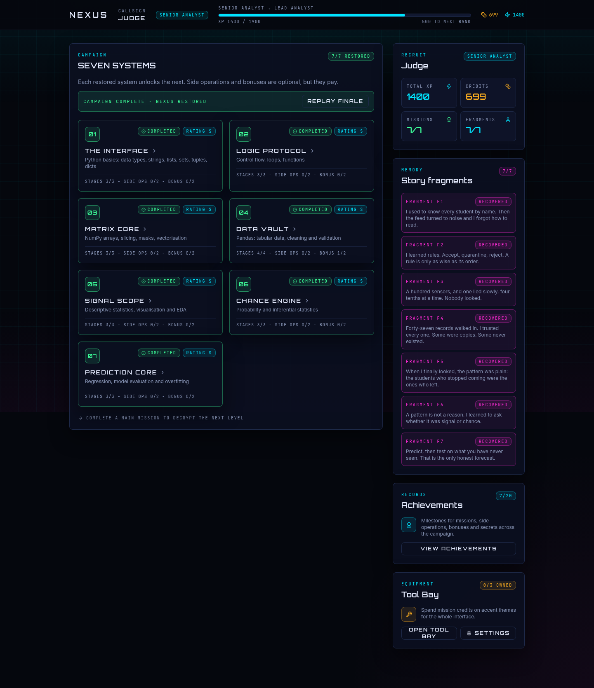
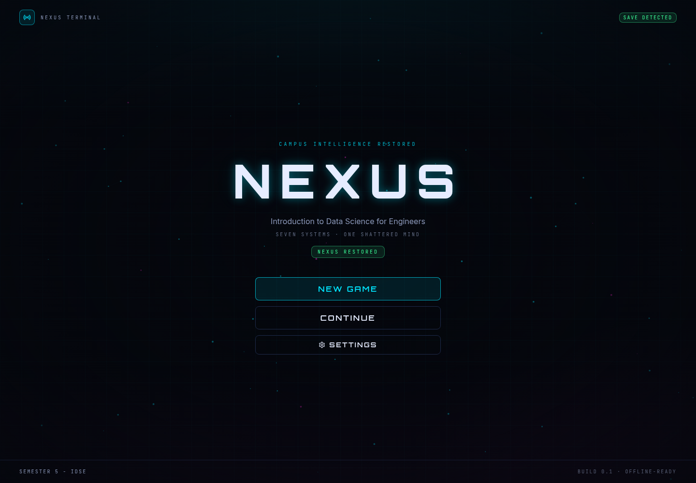
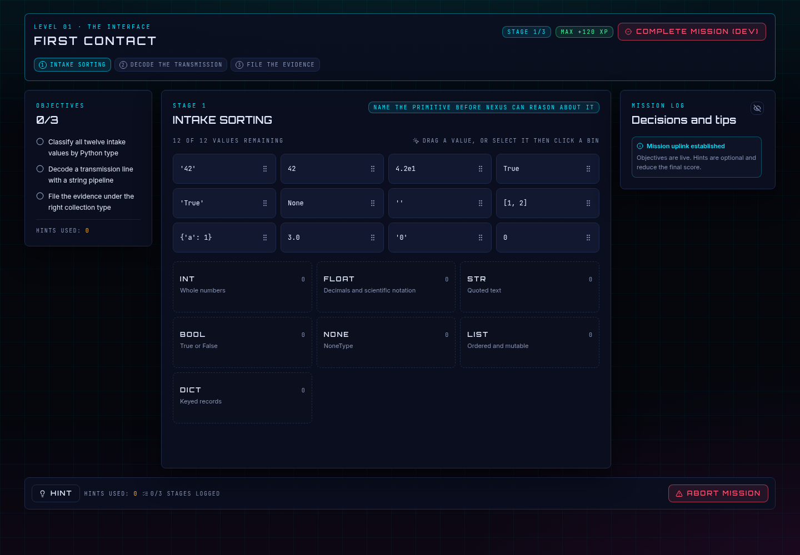
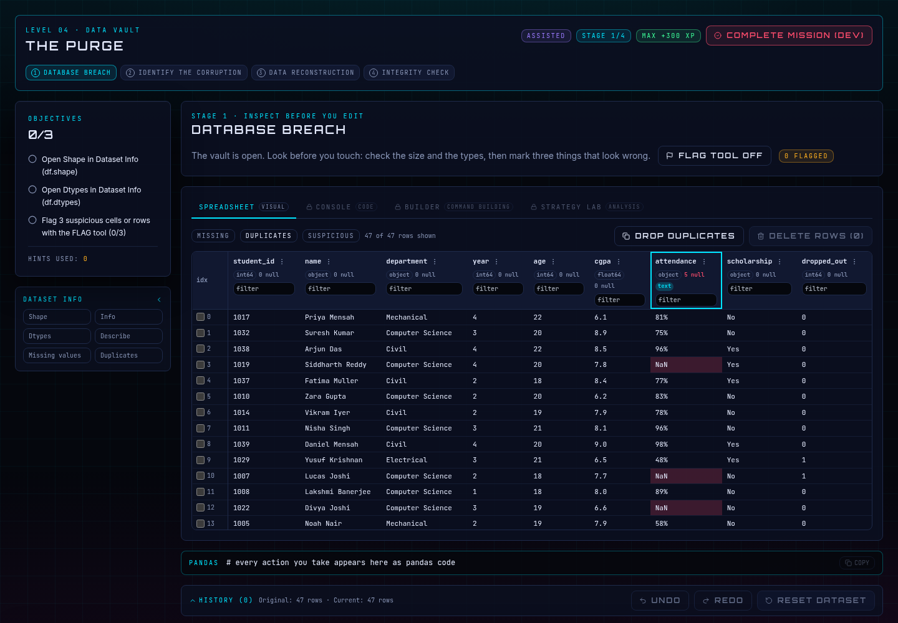
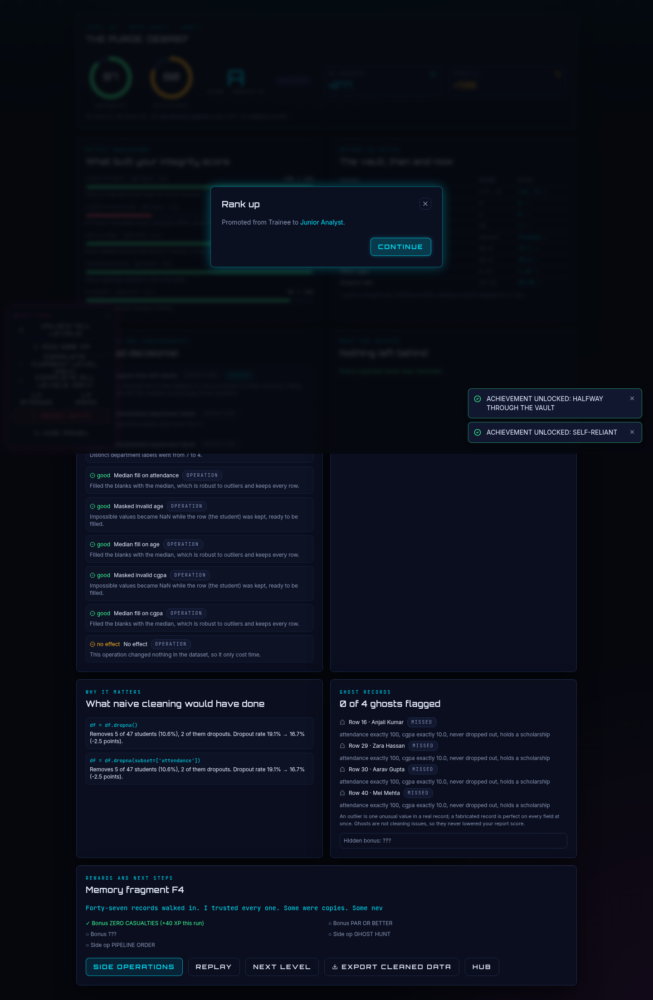
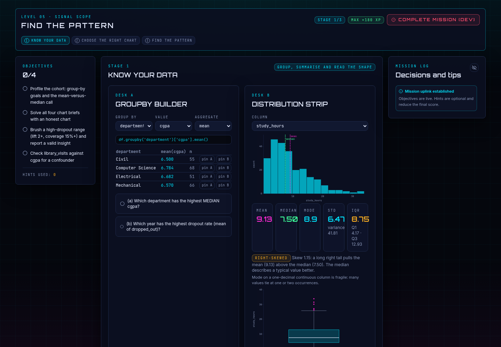
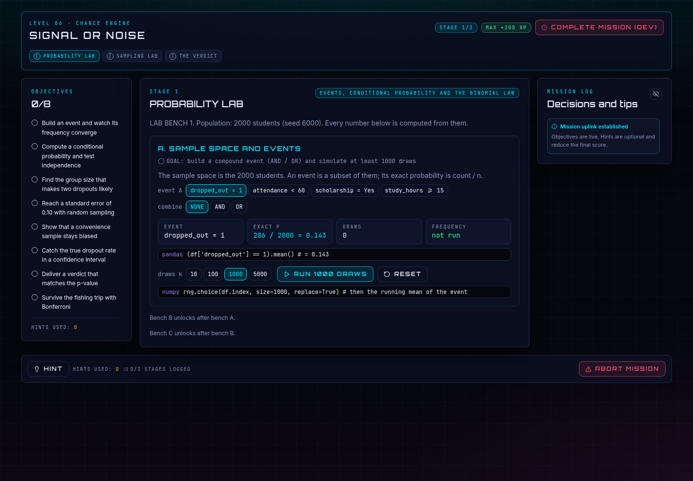
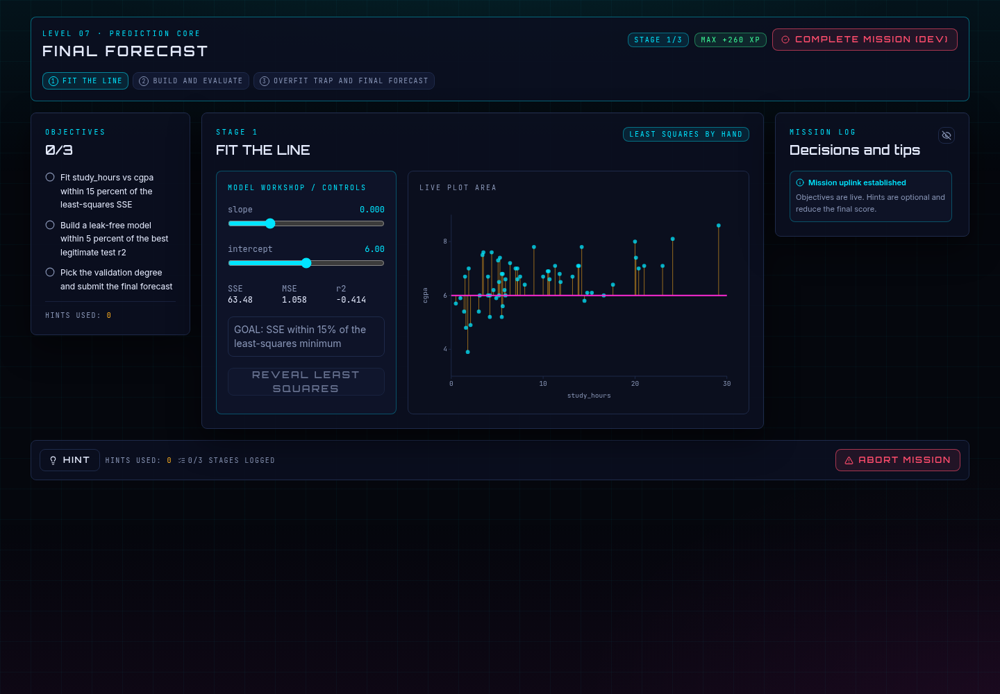
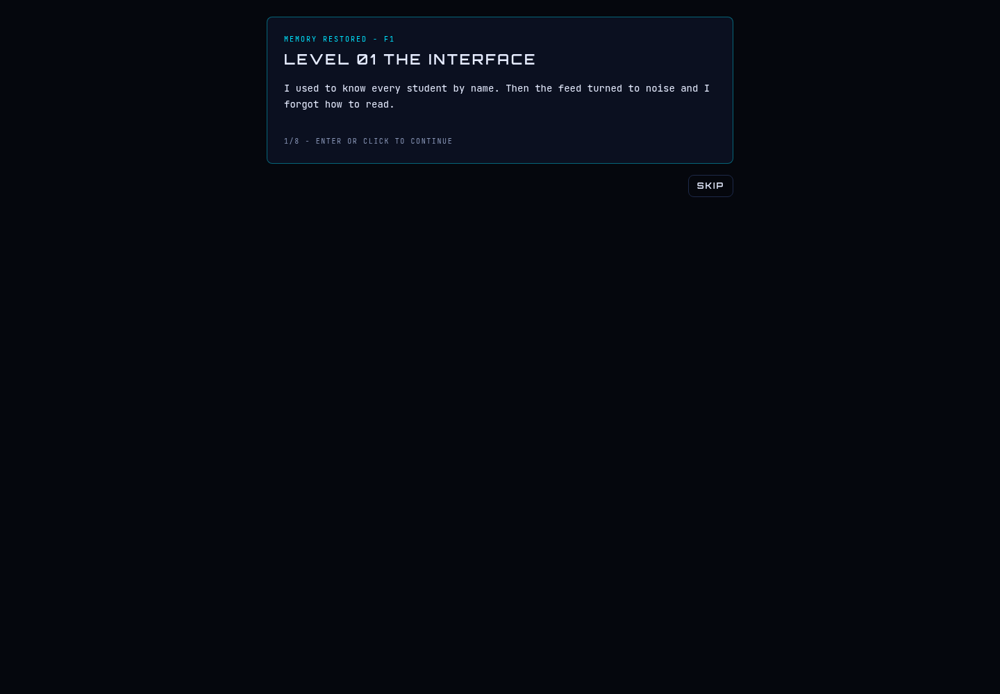

# NEXUS

**A mission-based browser game for _Introduction to Data Science for Engineers_ (IDSE), Semester 5.**

NEXUS is a campus intelligence that shattered when it learned to trust dirty data. You are the recruit who rebuilds it, one system and one memory fragment at a time. Each of the seven levels is a mission on real (generated) data, played through code-like operations whose consequences you can see. It is not a quiz: you order rules and run packets through them, slice arrays, clean a pandas-style table with undo and redo, build charts, run simulations and fit regression models.



## Educational objectives

The campaign follows the data-science pipeline from raw values to an honest forecast:

| Level | Title · mission | Syllabus topic | What the player does |
|---|---|---|---|
| 1 | THE INTERFACE · FIRST CONTACT | Python data types, strings, lists, sets, tuples, dicts | Sort values by type, build a string-cleaning pipeline, choose collections by running their consequences |
| 2 | LOGIC PROTOCOL · GATEKEEPER | Control flow, loops, functions | Order if/elif rules against 12 packets, configure loops with break/continue, assemble functions tested on hidden cases |
| 3 | MATRIX CORE · SIGNAL GRID | NumPy arrays, slicing, masks, vectorisation | Read shapes and dtypes, slice a sensor grid, vectorise, reshape, detect anomalies with IQR fences |
| 4 | DATA VAULT · THE PURGE | Pandas: tabular data, cleaning and validation | Inspect, flag and repair a corrupted student table in a spreadsheet, console or command builder, then pass an integrity audit |
| 5 | SIGNAL SCOPE · FIND THE PATTERN | Descriptive statistics, visualisation and EDA | Group-by summaries, mean/median/mode, spread and IQR, choose honest charts, brush a dropout pattern, check correlation and a confounder |
| 6 | CHANCE ENGINE · SIGNAL OR NOISE | Probability and inferential statistics | Events and conditional probability, binomial distribution, sampling distributions, confidence intervals, permutation tests, p-values, Bonferroni |
| 7 | PREDICTION CORE · FINAL FORECAST | Regression, model evaluation and overfitting | Fit a line by hand, build and evaluate models on train/test splits, catch a data leak, find the overfitting point, submit a sealed hold-out forecast |

## How to play

- **Campaign.** Start a new game with a callsign. Level 1 is open; finishing a level's main mission unlocks the next. Each level has a briefing, stages, a debrief with explained decisions, and a story fragment (F1 to F7). Finishing Level 7 opens the finale and a campaign summary.
- **Scoring.** Each mission is scored on accuracy, decision quality, efficiency and hint use, and rated S, A, B or C. XP and credits are paid on completion; replays pay only the improvement over your best.
- **Side operations and bonuses.** Every level has 2 optional side operations and 3 bonus objectives (one hidden, shown as ??? until earned). Each pays once.
- **Hints.** Every stage has 3 progressive hints. They are optional and lower the score slightly.
- **Ranks and credits.** XP raises your rank from Trainee to NEXUS Architect. Credits buy accent themes in the Tool Bay.
- **Level 04 clearance tiers.** ASSISTED (47 rows, highlights on), INDEPENDENT (~160 rows, no highlights) and EXPERT (~324 rows, informative missingness). Adaptive difficulty recommends a tier from your previous run, and a struggling player gets one free Analyst Scan.
- **Progressive coding.** Level 04 lets you work visually, build commands from parts, or type a safe pandas subset. All three modes edit the same dataset and history. Typing code is never required.

## Features

- Seven playable levels with 22 main stages, 14 side operations and 21 bonuses (7 hidden). Every count on screen is read from the level registry.
- Level 04 workspace: spreadsheet with dtype chips, highlights, inline edits, column menus with previews and view-only sorting; a pandas console with a hand-written parser (no `eval`); a command builder and fill-the-blank; a Strategy Lab that compares cleaning strategies on a copy; field puzzles; unlimited **undo / redo** with a source-tagged history; and a detailed audit debrief with CSV export.
- In-house SVG charts (scatter with brush, histogram, bar, box plot, line) with text summaries for screen readers.
- Deterministic, seeded data and simulations. Guarantees such as "the convenience sample is always biased" or "the validation curve is U-shaped" are tested across every reachable seed.
- 20 achievements, a Settings page (sound, volume, reduced motion, text size, theme), synthesised Web Audio sound, and a Tool Bay.
- Save reliability: export and import (validated, never half-applied), reset that requires typing RESET, save migration, a recovery screen for an unreadable save, an in-memory fallback with a banner when storage is blocked, and resuming Levels 4 to 7 after a refresh.
- Accessibility: keyboard reachable controls with a visible focus ring, a skip link, focus-trapped modals that close on Esc, `aria-live` toasts, reduced-motion support, and text or icons alongside colour.

## Tech stack

React 18, React Router 6 (HashRouter), Zustand 5 (state and persistence), TypeScript 5.6 (strict), Vite 5, Tailwind CSS 3, Vitest 2 with jsdom and Testing Library, lucide-react icons, and self-hosted Fontsource fonts (Inter, Orbitron, JetBrains Mono). There is no backend, no account and no network request at runtime.

## Requirements

Node.js 20 or newer (verified on Node 26) and npm.

## Install and run

```bash
npm ci          # exact install from package-lock.json
npm run dev     # open the printed URL, usually http://localhost:5173/
```

| Script | What it does |
|---|---|
| `npm run dev` | Development server (includes the developer panel and dev shortcuts) |
| `npm run build` | Type-check and build to `dist/` |
| `npm run preview` | Serve the production build locally |
| `npm test` | Run the Vitest suite once |
| `npm run typecheck` | `tsc -b` |
| `npm run verify` | Typecheck, then tests, then production build |

## Testing

`npm run verify` runs the typecheck, the full test suite (unit, engine, level, integration and release-audit tests) and the production build. Coverage includes the pandas-like engine and its golden cleaning script, every level's pure logic and guarantees, RTL flows for each stage, campaign progression, persistence, save validation, achievements and route smoke tests.

## Build and deploy

```bash
npm run build                                # dist/ for a root-hosted site
VITE_BASE=/nexus-idse-game/ npm run build    # for GitHub Pages at /nexus-idse-game/
```

The app uses hash routes (`#/hub`, `#/level/4/play`), so a static host needs no rewrite rules.

- **GitHub Pages:** push the repository, then build with `VITE_BASE=/nexus-idse-game/` and publish `dist/` (for example with a Pages GitHub Action, Settings → Pages → Source: GitHub Actions).
- **Netlify or Vercel:** drag and drop the `dist/` folder.

## Saves

Progress is stored in this browser's `localStorage`: `nexus-save-v1` holds the campaign, and `nexus-l04-session` to `nexus-l07-session` hold in-progress missions. Use Settings → EXPORT SAVE to back up and IMPORT to restore. RESET SAVE removes every `nexus-` key.

## Project structure

```
src/
  app/          App shell, routing, error boundary, recovery screen, systems bridge, dev panel (dev only)
  pages/        Title, NewGame, Hub, Settings, Achievements, ToolBay, Ending, level/ (Briefing, Play, Debrief, LevelGate)
  shell/        MissionShell, mission flow, persistent missions, debrief
  components/   charts/ (SVG), mechanics/ (DragSort, ChoiceSimulator), hub/
  engine/       Pure pandas-like engine, parser, generator, assessment, stats, cohort generator, seeded RNG
  game/         Types, config, progression, store, persistence, achievements, settings, sound, adaptive, level registry
  levels/       l01 … l07: definition, content, pure logic, components and tests per level
  test/         Test setup and the release audit
docs/           PROGRESS.md (build log and decisions) and screenshots/
```

## Screenshots

These were captured from the running game on the development server, so dev-only shortcuts such as "Complete mission (dev)" are visible. Production builds do not include them.

| | |
|---|---|
|  Title |  Level 1 intake sorting |
|  Level 4 spreadsheet |  Level 4 audit debrief |
|  Level 5 analysis desk |  Level 6 probability lab |
|  Level 7 model workshop |  Finale |

## Known limitations

- The console understands a documented subset of pandas, and the Level 3 mini-NumPy is limited to 1D/2D slicing; the UI says so.
- Statistics use simplified textbook methods (normal-approximation intervals without finite-population correction, permutation tests). These are noted where they are shown.
- Mission logs and console scrollback are not persisted. A refresh restores dataset, history, stage progress and inputs, but not the log text. Side operations restart from their first screen after a refresh.
- Levels 5 to 7 cycle through 50 seeds per level; after 50 replays the datasets repeat.
- The game is designed for screens at least 768 px wide; narrower screens show a notice.

## Credits and licence

Built for the IDSE course (Semester 5) by **TEAM LARP**:
- SAI NARESH P - EC24B1038
- BHARATH B - EC24B1040
- ADARSH G - EC24B1009

Released under the MIT licence (see `LICENSE`).
